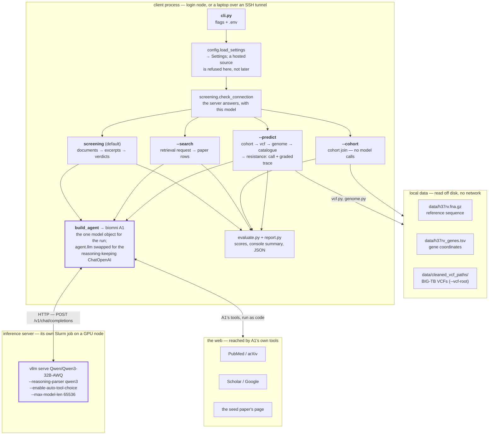

# tb-knowledge-discovery

Three capabilities, each one a run of the
[Biomni](https://github.com/snap-stanford/Biomni) A1 agent against a model you
serve yourself — vLLM on the cluster, or Ollama locally (see
[Serving the model](#serving-the-model-vllm-on-unity)). No hosted API, no key.

- **Retrieval** (`--search`) — give it a request such as "find me relevant papers
  like this paper <paper-url>". A1 resolves the seed paper and searches for
  related work with its own retrieval tools (`query_pubmed`, `query_arxiv`,
  `query_scholar`, `search_google`, `extract_url_content`), and the paper list
  is read out of its reply.
- **Screening** — hand it a folder of documents (PDF or plain text) and it
  returns a verdict per document: `tb_related`, a confidence, a reason, and an
  `evidence` quote that is checked against the excerpt the agent was shown
  (`evidence_verified`).
- **Resistance prediction from VCFs** (`--cohort`, `--predict`) — ingest the
  BIG-TB isolate VCFs, and for a given drug predict `resistant` /
  `not_resistant` / `unknown` with a reasoning trace. Calls are scored against
  the phenotypic DST labels, and each trace is graded against the variants the
  model was actually shown.

Serving the model ourselves is what makes the reasoning traces usable: a vLLM
server started with a reasoning parser returns the model's thinking separated
from its answer, and every prediction stores that trace verbatim beside the
variants it was shown. It is also what gives A1 a tool-calling backend that
costs GPU hours rather than per-token billing.

A1's system prompt is ~35k tokens and rides on every step of every run, so the
server has to be started with a context window well past that
(`--max-model-len 65536`) and with tool calling enabled. That is the one hard
requirement this design buys: there is no small-call fallback path.

## Setup

```bash
uv sync
cp .env.example .env   # optional: everything in it has a default
```

Every mode but `--cohort` needs a model server to call, and nothing in `.env`
is required to reach one: the defaults are `Qwen/Qwen3-32B-AWQ` at
`http://localhost:8000/v1`, so `--base-url` (or `VLLM_BASE_URL`) is all that
changes when the server lives on a compute node.

## Running the whole experiment

From a Unity login node:

```bash
module load uv      # run.sh's preflight fails without uv on PATH
uv sync             # once
./run.sh full       # the full four-drug run on an A100
./run.sh            # or the quick job: one drug, 8 isolates, 2h cap
```

That is the whole happy path — submit, serve the model, run the three stages,
package the results. No `.env` is needed; the job script passes `BASE_URL` and
`MODEL` to the pipeline itself.

Three things it does not do for you.

**The first run pays for the venv and the weights, inside the job.**
`run_unity_a100.sbatch` builds `~/vllm-venv` with `pip install vllm autoawq`
(~10 min), and then vLLM pulls `Qwen/Qwen3-32B-AWQ` — ~18 GB — into the default
HuggingFace cache under `$HOME`, which is both slow and more than a Unity home
quota wants to hold. Point it at work or project space first, once:

```bash
export HF_HOME=/work/pi_annagreen_umass_edu/$USER/hf
```

Doing that download in a throwaway `./run.sh` means the full job starts serving
in a couple of minutes instead of spending half an hour of its walltime on
setup.

**The VCFs have to be readable from the node.** `big_tb_file_paths.txt` records
them under `/project/pi_annagreen_umass_edu/anna/BIG-TB_v2/isolates/`, so the
run needs read access to that project space and those paths need to still be
valid; `VCF_ROOT=/path/to/vcfs ./run.sh full` if they have moved. The cohort
join is the cheap way to check, because no model is involved:

```bash
uv run cli.py --cohort -o /tmp/cohort.json
```

**`./run.sh full` is not the full cohort.** It is four drugs at `LIMIT=20`
balanced isolates — 80 predictions — not the 17,942 isolates in the path list.
For a real sample size, say so:

```bash
DRUGS="rifampicin isoniazid ethambutol pyrazinamide streptomycin amikacin" \
LIMIT=100 ./run.sh full
```

and that will not fit the job's 8 h walltime. Each prediction is a multi-step
A1 run carrying a ~35k-token system prompt on every step, so take the
per-prediction time from a quick run's log before scaling, then either raise the
walltime (`SBATCH_ARGS="--time=24:00:00"`) or split the drugs across separate
jobs with their own `RUN_ID`. Coverage limits the drug list too: rifampicin and
isoniazid have ~17.5k labelled isolates, but the rarely tested drugs have a few
dozen, so a large `--limit` with `--balance` quietly returns fewer for those.

Then wait. `run.sh` submits the job, prints why it is still pending while it
is, follows the log once it starts, and ends by printing the run's summary and
the folder and tarball to send on. Ctrl-C detaches without cancelling the job;
`./run.sh --attach <jobid>` picks it back up, and `scancel <jobid>` is the way
to actually stop it. It checks for `uv`, the job script and the resistance
table before submitting, so the usual reasons a job dies ten minutes in show
up on your terminal instead of at the bottom of a log.

Everything below still works and `run.sh` passes it through:

```bash
DRUGS="rifampicin isoniazid" LIMIT=20 ./run.sh full
QUICK_LIMIT=4 ./run.sh
```

`run_experiment.sh` is the layer underneath — the three stages themselves —
and can still be run directly:

```bash
./run_experiment.sh
```

From a Unity login node that submits `scripts/run_unity_a100.sbatch`, which
takes an A100, serves the model, and runs this same script against it. With a
server already up it runs here instead. Three stages: the cohort join (no model
involved, so it fails fast if the data is unreadable), resistance prediction
per drug, and literature screening against the hand labels in `eval/`. A stage
that fails is recorded and the rest still run.

Everything lands in `results/<run-id>/`, which is the folder to hand to someone
else — raw JSON exactly as the pipeline wrote it, every stage's full log, the
model and commit and seed the numbers came from, and a `SUMMARY.md` that reads
first. `scripts/collect_results.sh` is what writes that summary, the
`metrics.csv` beside it and a `.tar.gz` of the folder; `run_experiment.sh`
calls it at the end, and you can re-run it on any run folder:

```bash
scripts/collect_results.sh                    # the newest run
scripts/collect_results.sh results/<run-id>   # a particular one
```

Every run is also sampled while it runs. `scripts/monitor_run.sh` is started
and stopped by `run_experiment.sh`, and writes two timelines into the run's
`logs/`: `gpu_timeline.csv` (utilisation, memory, power, temperature) and
`server_timeline.csv` (vLLM's requests running and queued, KV-cache occupancy
and generation tokens per second). `logs/stages.jsonl` records each stage's
exit code, start time and duration beside them. These answer the question the
stage logs cannot — whether a slow run was slow because the card was saturated
or because it sat idle waiting on the agent — and `SUMMARY.md` carries the
headline figures under **Run monitoring**.

`results/runs.csv` is one row per run across every run that has finished,
successful or not: model, effort, seed, commit, which stages failed, total
time, mean GPU utilisation and mean tokens per second. It is rewritten by
run id, so re-running `collect_results.sh` on a folder corrects that run's row
rather than adding another.

To watch a Slurm job, including the live timelines and stage durations:

```bash
scripts/watch_job.sh              # the newest job of yours in the queue
scripts/watch_job.sh 1234567      # a particular one
scripts/monitor_run.sh status results/<run-id>    # just the last samples
```

The knobs are environment variables, so the defaults stay out of the command:

```bash
DRUGS="rifampicin isoniazid" LIMIT=40 EFFORT=high ./run_experiment.sh
VCF_ROOT=/project/.../vcfs ./run_experiment.sh    # VCFs not where the cohort says
```

`DRUGS` (default: rifampicin, isoniazid, ethambutol, pyrazinamide), `LIMIT`
isolates per drug, `BALANCE=1` for equal R and S, `SEED` so a run repeats,
`EFFORT`, `RUN_ID` to name the folder, and `BASE_URL`/`MODEL` to point at a
server yourself.

## Resistance prediction from VCFs

The dataset comes from two files in `data/cleaned_vcf_paths/`:
`master_resistance_table.csv` (phenotypic DST, R/S per isolate per drug) and
`big_tb_file_paths.txt` (the BIG-TB VCF paths on the cluster). They join on the
table's `New_ID` column, which matches the VCF filename stem for all 17,942
BIG-TB isolates, giving a labelled dataset per drug — 17.6k isolates for
rifampicin, 17.4k for isoniazid, down to a few dozen for the rarely tested
drugs.

Variants are named without needing an annotated VCF. Each position is looked up
in `data/h37rv_genes.tsv` (NCBI's feature table for H37Rv, NC_000962.3) to get
the gene, the codon number, or a promoter offset, and the codon is then
translated against the reference in `data/h37rv.fna.gz` to get the actual
protein consequence. So `761155 C>T` is presented as `rpoB S450L`, `761156 G>A`
as `rpoB S450S synonymous`, `1673425 C>T` as `fabG1 -15 (promoter)` and a 1 bp
deletion in pncA as a frameshift. When the VCF carries its own `ANN`/`CSQ`
field, that annotation is used instead.

Naming the protein change matters more than it looks: shown only "rpoB codon
453", the model calls any hotspot codon resistant, because it cannot tell a
silent change from a missense one. Shown "rpoB S450S synonymous", it correctly
rules the variant out.

Because the reference is loaded anyway, every record's `REF` is checked against
H37Rv. A run that reports mismatches was called against a different reference or
has shifted coordinates, and its gene and codon assignments cannot be trusted.

Variants are then filtered to the genes the WHO catalogue grades for that drug,
split into tier 1 (established mechanism) and tier 2 (secondary).

**Each trace is checked, not just read.** Every prediction is stored next to the
variants it was shown, so three things are verified mechanically:

| check | what it catches |
| --- | --- |
| `variants_resolve` | the model cited a variant that was never in the VCF |
| `genes_on_panel` | the model reasoned from a gene not graded for that drug |
| `call_grounded` | a `resistant` call that rests on no variant at all |

`tier1_support` additionally records whether the call rests on a tier 1 gene
rather than only a secondary one. A trace is `valid` when nothing in it was
invented or self-contradictory — accuracy and trace validity are reported
separately, because a run can be accurate and still be reasoning from variants
that were not there.

```bash
# the labelled dataset size per drug; no LLM calls
uv run cli.py --cohort

# predict, on a balanced sample, with the VCFs mounted locally
uv run cli.py --predict isoniazid --limit 40 --balance --vcf-root /path/to/vcfs
uv run cli.py --predict rifampicin --limit 100 --balance --seed 1
```

The BIG-TB VCFs live on the cluster, so `--vcf-root` points at wherever they
actually are; without it the recorded cluster path is used as-is. A run prints
one line per isolate (the call, whether it matched the DST, and any trace
problem) and ends with accuracy, sensitivity, specificity, PPV/NPV, the
confusion matrix and the trace rates. `tb_resistance_<drug>.json` holds every
prediction with its variant list, reasoning and trace grade.

## Serving the model (vLLM on Unity)

The model runs on our own hardware, which is what puts the model choice, the
reasoning settings and the response format under our control — and lets the
server hand back the model's thinking as its own field instead of leaving it
mixed into the answer.

Biomni has two backends that serve a model locally, and both drive the A1
agent:

| `--source` | what it is | reasoning traces |
| --- | --- | --- |
| `Custom` (default) | any OpenAI-compatible server, i.e. `vllm serve` | separated into `reasoning`, captured per prediction |
| `Ollama` | a pulled Ollama model on its own port | only what the model leaves in `<think>` tags |

`Custom` is the one to use on the cluster. The default model is
`Qwen/Qwen3-32B-AWQ`: vLLM serves it with a `qwen3` reasoning parser *and* with
tool calling, and biomni reaches it as an ordinary OpenAI-compatible model,
which is what A1 needs to call its tools — all three at once, which not every
model manages.

`scripts/run_unity_a100.sbatch` is the whole cluster side: one Slurm job that
takes an A100, serves the model, waits for it to come up, and then runs the
pipeline against it. Everything after the script name goes to `cli.py`:

```bash
sbatch scripts/run_unity_a100.sbatch --predict rifampicin --limit 40 --balance
sbatch scripts/run_unity_a100.sbatch --search "fluoroquinolone resistance"
sbatch scripts/run_unity_a100.sbatch        # no args: serve only, and hold
tail -f logs/tb-a100-<jobid>.out            # prints the --base-url to use
```

With no arguments it holds the server for the rest of the walltime, which is
the mode to use when the client is somewhere else — a tunnel from a laptop, or
an interactive session. With arguments it kills the server as soon as the run
finishes, so the card is not held for nothing.

The model is quantized because of the card. Unity's `a100` nodes are compute
capability 8.0, which has no native FP8, so 4-bit AWQ is the quantization that
runs there: `Qwen/Qwen3-32B-AWQ` is ~18 GB of weights, leaving the rest of a
40 GB card (and most of an 80 GB one) to the KV cache at the 64k context A1
needs — one GPU is enough for every mode. vLLM reads the AWQ config out of the
checkpoint and picks the `awq_marlin` kernel itself, so there is no
`--quantization` flag to pass. `MODEL=Qwen/Qwen3-8B` serves the bf16 8B on the
same job instead; same family, so the parsers are unchanged and only the served
id passed to the client changes.

The job asks for `--partition=gpu-highvram --gres=gpu:a100:1`. Both halves
matter: Unity's default partition is `cpu`, which refuses a `--gres` at all, and
its plain `gpu` partition holds titan_x/v100/1080_ti/2080_ti/m40/l4/a16 but no
A100 — so `--partition=gpu --constraint=a100` is unsatisfiable. `sinfo -o '%P %G
%f' | grep a100` is the list that settles which partitions have them:
`gpu-highvram` (non-preemptible, the default here), `gpu-preempt-highvram`,
`superpod-a100`, and the PI partitions `cbio-gpu`, `ece-gpu`, `umd-cscdr-gpu`.
To aim the job elsewhere, pass `SBATCH_ARGS` instead of editing the file; it
overrides the job's own directives:

```bash
SBATCH_ARGS="--partition=gpu-preempt-highvram" ./run_experiment.sh
SBATCH_ARGS="--constraint=a100-80g" ./run_experiment.sh   # 80 GB cards only
```

A failed submission prints the GPU nodes the cluster actually offers, which is
the list to choose from. Walltime and the venv holding vLLM are set at the top
of the job file. It runs, in effect:

```bash
vllm serve Qwen/Qwen3-32B-AWQ --port 8000 \
    --gpu-memory-utilization 0.90 \
    --reasoning-parser qwen3 \
    --enable-auto-tool-choice --tool-call-parser hermes \
    --max-model-len 65536
```

`--reasoning-parser` is what separates the thinking into the response's
`reasoning` field ([vLLM
docs](https://docs.vllm.ai/en/stable/features/reasoning_outputs/)); the parser
name has to match the model family. `--enable-auto-tool-choice` is what lets
the A1 agent do its tool calling against this server, and `--max-model-len` has
to clear A1's ~35k-token system prompt for anything to work at all.

Then point any mode at it. biomni runs here, in this process, and knows the
inference engine only by URL:

```bash
# resistance prediction, with thinking captured per isolate
uv run cli.py --predict rifampicin --limit 40 --balance \
    --base-url http://gpu042:8000/v1 --model Qwen/Qwen3-32B-AWQ \
    --reasoning-effort high

# from a laptop, through a tunnel: ssh -N -L 8000:gpu042:8000 unity.rc.umass.edu
uv run cli.py --predict isoniazid --base-url http://localhost:8000/v1 ...

# a retrieval run against the same server
uv run cli.py --search "papers like <url>" --base-url http://gpu042:8000/v1
```

`--base-url` is biomni's `Custom` source, which A1 takes too, so the agent's
own tool calling runs against that same server; no API key is involved.
Before anything else runs,
the endpoint is pinged and its model list checked, so a job that has not come up
yet — or a model id that is not the one being served — fails immediately
instead of mid-run (`--source Ollama` is checked the same way, against
`ollama`'s own list of pulled models).

A local server has no rate limit, so there is nothing to wait out; a request
that fails on a busy or restarting server is retried twice, while one that fails
on context length is not, because it would fail again identically.

`--reasoning-effort` goes out as the request's `reasoning_effort`, which vLLM
maps onto the chat template's thinking switch. It is recorded in the output
JSON, because traces are only comparable across runs at the same effort.

**What ends up in the traces.** Each prediction carries two: `reasoning`, what
the model wrote into its answer, and `reasoning_trace`, the thinking the server
separated out. They can disagree, and the second is the one that shows how the
call was actually reached, so it is what the biological-validity read-through
works from. The run summary reports how many calls came with thinking attached
and the median length; a model served without a reasoning parser yields empty
traces and the summary says so.

With `reasoning_content` being the field's older spelling, and langchain's
`ChatOpenAI` dropping both as non-standard, `tb_search/screening.py` subclasses
it to keep them — otherwise the traces never reach us at all.

A1 makes that harder than a plain chat call does. Its `generate` step rebuilds
every reply as a fresh `AIMessage`, so `additional_kwargs` — and the
`reasoning` field with it — is gone by the time the step reaches the agent's
graph state. So the subclass also appends each trace to a list that
`build_agent` hands it, and `run_agent` reads that list back per run: the whole
run's thinking, step by step, which with a tool loop in the middle is what the
answer was actually reasoned from.

## Usage

**Screening local documents**

```bash
uv run cli.py                        # screens ./papers, or ../papers when ./papers is absent
uv run cli.py ../papers               # any directory or single PDF/text file
uv run cli.py -o out.json             # default output: tb_verdicts.json
uv run cli.py --batch-size 1          # one document per agent run, for a tight context window
uv run cli.py --gold eval/screening_gold.json   # plus accuracy against hand labels
```

Documents go to the agent `--batch-size` at a time, as section-aware excerpts
(the opening, plus the starts of the methods and closing sections — the opening
alone cannot tell a TB methods paper from one that names TB in passing). A batch
whose reply will not parse is retried once with a stricter reminder, then left
as `unknown`, so one bad agent run cannot end a pass over a whole directory.

**Retrieval**

```bash
uv run cli.py --search "find me relevant papers like this paper https://www.biorxiv.org/content/..."
uv run cli.py --search "..." -n 20 -o found.json   # at most 20 papers
uv run cli.py --search "..." --verbose             # biomni's full step-by-step agent output
```

A retrieval run echoes the agent's searches as it makes them (the step number in
brackets), then the papers it settled on:

```
Searching for up to 10 paper(s) [A1 agent, Custom Qwen/Qwen3-32B-AWQ @ http://gpu042:8000/v1]
  query: find me relevant papers like this paper https://...

  [2] extract_url_content(https://www.biorxiv.org/content/...)
  [4] query_pubmed(rifampicin resistance prediction whole genome sequencing)
  [6] query_scholar(tuberculosis drug resistance benchmark)
  [8] agent wrote up its answer

Papers related to the query (8):
   1. TB-Bench: A Systematic Benchmark of ... (2026) [pubmed]
      https://doi.org/10.64898/2026.04.08.717138
      Provides a TB drug resistance benchmark similar to BIG-TB.
```

Every row has to carry a title the agent actually returned, and the agent is
told never to invent one — but unlike a search against a source API directly,
nothing here can *prove* a row came from a real record. Spot-check the links.

## Architecture

Two processes and an HTTP boundary. The pipeline runs wherever you launched it
— a login node, or a laptop through an SSH tunnel — and knows the model only as
a URL; the model runs in its own Slurm job on a GPU node. Nothing in the
pipeline holds weights, and nothing in the server holds pipeline state, so the
server can be restarted, resized or swapped for a different model id without
touching the code.



The layering is deliberate in three places:

- **Biomni supplies the agent; the pipeline around it is this repo's.** A1
  brings the tool loop, the tool catalogue and its own ~35k-token system
  prompt. Every task prompt, the VCF reader and all the grading are this
  repo's (see [How it uses Biomni](#how-it-uses-biomni)).
- **The genomic layer is pure and offline.** `vcf.py`, `genome.py` and
  `catalogue.py` turn a VCF into named, panel-filtered variants with no model
  in the loop, which is why `tests/` can cover them without a server.
- **Grading is separate from predicting.** `resistance.check_trace` and
  `evaluate.py` only read rows, so a finished run can be re-scored from its JSON.

## How a run flows

Every mode enters through `cli.py`, which parses flags, loads `Settings` from
`.env` and picks a path. Everything below the CLI is plain Python, and every
model call is `run_agent` — one `agent.go()` over one task prompt.

**Screening (the default mode)**

```
cli.py run_screening
  load_settings            config.py      .env -> Settings
  resolve_input            documents.py   the directory or single file to read
  collect_docs             documents.py   every PDF/text under it
  check_connection         screening.py   the server's model list + a 1-token call, so a server that is down fails here
  build_agent              screening.py   biomni.agent.A1, wired to our server
  classify_documents_agent screening.py   one agent run per --batch-size documents
    section_excerpt        documents.py   opening + methods + conclusion
    BATCH_SCREEN_PROMPT    prompts.py     the listing -> one JSON list
    run_agent              screening.py   agent.go, plus the run's thinking
    parse_verdict_list     verdicts.py    salvage that JSON from prose or code fences
    quote_in_text          verdicts.py    the evidence quote checked against the excerpt
  write_results            report.py      console lines + tb_verdicts.json
```

**Retrieval (`--search`)**

```
cli.py run_search
  build_agent            screening.py   as above
  retrieve_papers        retrieval.py   one agent run on the request
    RETRIEVAL_PROMPT     prompts.py     fetch the seed, then search; reply as a JSON list
    go_stream            biomni         step by step, so the searches can be echoed
    _searches            retrieval.py   the tool calls, read back out of the code A1 wrote
    parse_paper_list     verdicts.py    salvage the rows from the final reply
  write_papers           report.py      rows -> tb_papers.json
```

`--predict` is the same shape per isolate: the VCF is read and named offline,
`RESISTANCE_PROMPT` hands the agent the numbered variant list, and the reply is
parsed, normalized and then checked against what was in that list.

## The lifecycle of one request

Setup happens once per run; the rest repeats per document, per candidate paper
or per isolate. The model is never trusted to have answered well — every reply
is salvaged, normalized and checked before it becomes a row.

```mermaid
flowchart TB
    subgraph setup["once, before the first call"]
        L1["config.load_settings<br/>.env + flags → Settings"]
        L2["screening.check_connection<br/>the model list, then a 1-token call:<br/>a server that is down, or serving a<br/>different id, fails here"]
        L3["screening._prime_environment<br/>BIOMNI_CUSTOM_BASE_URL / _API_KEY,<br/>where biomni's own code looks"]
        L4["build_agent<br/>one A1 agent for the whole run;<br/>agent.reasoning_traces attached"]
        L1 --> L2 --> L3 --> L4
    end

    subgraph percall["per document, per candidate paper, per isolate"]
        P1["task prompt built — prompts.py<br/>a batch of section excerpts, a numbered<br/>variant listing, or the retrieval request"]
        P2["screening.run_agent<br/>agent.go — A1's tool loop, its ~35k-token<br/>system prompt on every step"]
        P3["screening.retry_transient<br/>POST /v1/chat/completions, per step"]
        P4["vLLM<br/>prefill → decode; the reasoning parser<br/>splits the thinking out of the answer"]
        P5["(answer, trace) — langchain drops that<br/>field as non-standard and A1 rebuilds the<br/>message, so the ChatOpenAI subclass files<br/>each trace in agent.reasoning_traces;<br/>on Ollama it comes out of the think tags"]
        P6["verdicts.parse_verdict_list<br/>or resistance.parse_prediction<br/>the JSON, out of prose, fences or solution tags"]
        P7["verdicts.quote_in_text — screening<br/>the evidence quote checked against the excerpt<br/><br/>normalize_prediction — resistance.py<br/>the call folded to one of three"]
        P8["resistance.check_trace<br/>variants_resolve, genes_on_panel,<br/>call_grounded, tier1_support"]
        P9["one row, always"]
        P1 --> P2 --> P3 --> P4 --> P5 --> P6 --> P7 --> P8 --> P9
        RETRY["a busy or restarting server:<br/>retried twice. a context-length<br/>failure: not retried, it would repeat —<br/>cut --batch-size or raise --max-model-len"]
        P3 -.-> RETRY -.-> P3
        P6 -.->|"unreadable VCF, failed call,<br/>unparseable reply → a row<br/>carrying an error, so one bad<br/>input cannot end a sweep"| P9
    end

    subgraph finish["once, at the end"]
        F1["evaluate.py<br/>accuracy and trace validity scored apart:<br/>a run can be accurate and still reason<br/>from variants that were not there"]
        F2["report.py<br/>console summary + JSON, with the model id<br/>and reasoning effort recorded — traces<br/>only compare across runs at equal effort"]
        F1 --> F2
    end

    L4 --> P1
    P9 -->|"next item"| P1
    P9 --> F1

    classDef remote stroke-width:3px
    class P4 remote
```



One `agent.go()` is however many requests A1's tool loop needs, each carrying
that system prompt, so the per-item cost is set by how many steps the agent
takes rather than by the task prompt's length. `--tools` lets A1 retrieve a
relevant tool subset instead of carrying the whole catalogue, which is the one
lever on that cost short of a smaller prompt.

## How it uses Biomni

Biomni supplies the agent; the pipeline around it is this repo's, including
every task prompt (`prompts.py`). A1 brings its own system prompt — who it is,
the tool catalogue, the `<execute>`/`<solution>` protocol — but no task prompts,
because its design is that the caller supplies the task in `agent.go(...)`.
The touchpoints are few:

| Biomni piece | Where | Used for |
| --- | --- | --- |
| `biomni.agent.A1` | `screening.build_agent` | the one model object: tool loop, tool retriever, data-lake switch |
| `biomni.config.default_config` | `screening.build_agent` | temperature, model and provider; A1 forwards `llm`/`source` but not `temperature` |
| `agent.go(prompt)` | `screening.run_agent` | every task: screening batches, and one resistance prediction per isolate |
| `agent.go_stream(prompt)` | `retrieval._run_streamed` | search step by step, so its tool calls can be echoed |
| A1's retrieval tools | the `--search` run | `query_pubmed`, `query_arxiv`, `query_scholar`, `search_google`, `extract_url_content`, called as code inside `<execute>` |

Six details are easy to get wrong, which is why the code spells them out:

- The source is always passed explicitly. Biomni's auto-detection sees the
  slash in a HuggingFace id like `Qwen/Qwen3-32B-AWQ` and would route it to Ollama
  on its own. `Custom` is the branch that points langchain at our server; A1
  takes `base_url` too, so the agent's tool calling runs against it.
- The endpoint is copied into the environment (`BIOMNI_CUSTOM_BASE_URL`,
  `BIOMNI_CUSTOM_API_KEY`) before `A1` is built, because Biomni reads it from
  there, not from our `Settings`.
- A1 builds its own chat model, so `build_agent` replaces `agent.llm` with the
  reasoning-keeping one afterwards; it stays a `ChatOpenAI` subclass because A1
  calls `with_structured_output` on it.
- `expected_data_lake_files=[]` (not `None`) is what tells A1 to skip its
  tens-of-GB data-lake download; `--data-lake` turns it back on.
- `timeout_seconds` comes from `BIOMNI_TIMEOUT_SECONDS` (default 600) and is
  passed only to A1.
- A1's `generate` step appends a **new** `AIMessage` built from the reply's text,
  so `additional_kwargs` never reaches the graph state and `go()` hands back a
  bare string. The reasoning is therefore collected at the chat model, in
  `agent.reasoning_traces`, and `run_agent` clears that list per run so one
  isolate's thinking is not filed under the next.

That system prompt rides on every step of every run, so the per-item cost is
real: a sweep over thousands of isolates pays it thousands of times, and
`--tools` (a retrieved tool subset) is the lever on it. Where a run can still
fail, `retry_transient` retries a busy or restarting server twice, and a failure
is reported per batch or per isolate instead of ending the run.

## Flags

| flag | meaning |
| --- | --- |
| `input` (optional) | Directory or file to screen; defaults to `./papers`, else `../papers` |
| `--search QUERY` | Retrieval request; typically names a seed paper by URL/DOI. Output: `tb_papers.json` |
| `-n`, `--top` | `[--search]` Upper bound on papers returned, most relevant first (default 10) |
| `--gold JSON` | `[screening]` Hand labels `{filename: true/false}`; prints accuracy |
| `--cohort` | Join the resistance table to the listed VCFs; per-drug dataset sizes. Output: `tb_cohort.json` |
| `--predict DRUG` | Predict resistance to DRUG from each isolate's VCF, with a checked trace. Output: `tb_resistance_<drug>.json` |
| `--vcf-root DIR` | `[--predict]` Where the VCFs actually live, replacing the recorded cluster path |
| `--data-dir DIR` | `[--cohort]`, `[--predict]` Where the cohort files live (default `data/cleaned_vcf_paths`) |
| `--limit N` | `[--predict]` Isolates to predict over (default 20) |
| `--balance` | `[--predict]` Equal numbers of resistant and susceptible isolates |
| `--seed N` | `[--predict]` Sampling seed, so a run repeats (default 0) |
| `--min-af` | `[--predict]` Drop variants below this alternate-allele frequency (default 0, keep all) |
| `--keep-filtered` | `[--predict]` Also use variants the caller did not mark PASS |
| `-o, --output` | JSON results path (default `tb_verdicts.json`, or `tb_papers.json` with `--search`) |
| `--model` | Model id to request: on vLLM the id the server was started with, on Ollama the pulled tag (default: `$VLLM_MODEL` or `Qwen/Qwen3-32B-AWQ`) |
| `--base-url URL` | Where the model is served, e.g. `http://gpu042:8000/v1` (default: `$VLLM_BASE_URL` or `http://localhost:8000/v1`). A1 does its tool calling against it too |
| `--reasoning-effort LEVEL` | Reasoning effort sent with every request: `none`, `minimal`, `low`, `medium`, `high`, `xhigh`, `max` (default: `$LLM_REASONING_EFFORT`, else the server's own default) |
| `--source` | Which biomni backend serves the model: `Custom` (any OpenAI-compatible server, i.e. vLLM) or `Ollama` (default: `$LLM_SOURCE` or `Custom`). Both drive A1; only `Custom` hands back separated traces |
| `--batch-size` | `[screening]` Documents per agent run (default 2) |
| `--max-chars` | Excerpt length per document (default 3000) |
| `--tools` | Let A1 retrieve a relevant tool subset instead of carrying them all |
| `--data-lake` | Let biomni pull its full data lake (tens of GB) |
| `--temperature` | Sampling temperature (default 0.2) |
| `--verbose` | `[--search]` Also print biomni's full step-by-step agent output |

## Layout

```
run.sh             submit, wait, follow, summarise — the one to run
run_experiment.sh  the three stages themselves; writes results/<run-id>/
cli.py             CLI entry point
scripts/
  run_unity_a100.sbatch     one Slurm job: serve the quantized model on a Unity
                            A100, then run the pipeline against it
  run_unity_quick.sbatch    the same experiment on any Ampere-or-newer card
                            with >=23 GB, sized to clear the queue faster
  collect_results.sh        SUMMARY.md, metrics.csv and a tarball for a run folder
  monitor_run.sh            samples the GPU and the vLLM server during a run
  watch_job.sh              queue state, stage progress and timelines, refreshed
tb_search/
  config.py        Settings loaded from .env / environment: which local backend, which model
  reasoning.py     reasoning effort, and pulling a reply's thinking out of it
  documents.py     collect files, extract text and section-aware excerpts
  prompts.py       the task prompts handed to A1: screening, retrieval, resistance
  verdicts.py      salvage JSON out of whatever the model returned; check a quote against its text
  evaluate.py      screening accuracy, resistance scoring, trace grading
  screening.py     A1 construction, one-run-per-prompt, and agent screening
  retrieval.py     one A1 agent run: query (+ seed paper URL) -> paper rows
  report.py        summary line + JSON output (verdicts, searches, predictions)
  genome.py        H37Rv position -> gene, codon, promoter offset, protein change
  catalogue.py     WHO drug -> resistance gene panels, tier 1 and tier 2
  vcf.py           read a VCF into named, panel-filtered variants
  cohort.py        join the resistance table to the VCF paths; per-drug datasets
  resistance.py    predict resistance for one isolate/drug, and grade the trace
data/
  h37rv_genes.tsv        H37Rv gene coordinates (from NCBI NC_000962.3)
  h37rv.fna.gz           the H37Rv reference sequence, for protein consequences
  cleaned_vcf_paths/     the resistance table and the BIG-TB VCF path list
eval/              hand labels for screening
tests/             offline tests for the VCF pipeline and the model layer
```
