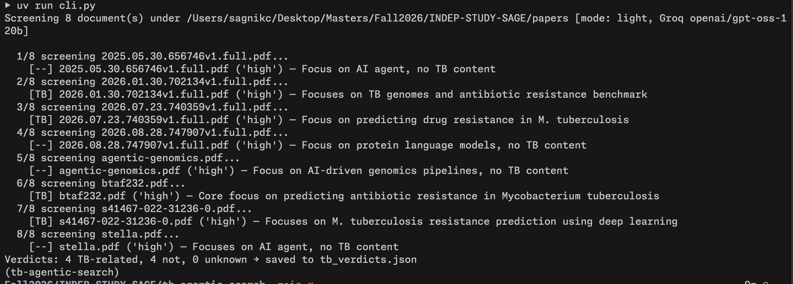

# tb-agentic-search



Two capabilities, both wired to [Biomni](https://github.com/snap-stanford/Biomni)'s
Groq plumbing:

- **Retrieval** (`--search`) — give the Biomni A1 agent a request such as
  "find me relevant papers like this paper <paper-url>"; it resolves the seed
  paper, then uses its literature tools (PubMed, arXiv, Scholar, web search) to
  find related papers. You don't hand it local files.
- **Screening** — hand it a folder of documents (PDF or plain text) and it
  returns a verdict per document: `tb_related`, `confidence`, `reason`.

Screening has two modes:

- **light** (default) — one small LLM call per document (~1k tokens), so a free
  Groq account's 8000-tokens-per-minute budget holds.
- **`--agent`** — the full Biomni A1 agent tool loop. A1's system prompt is
  ~35k tokens, so this needs a Groq tier with a bigger TPM budget.

## Setup

```bash
uv sync
cp .env.example .env   # then fill in GROQ_API_KEY
```

## Usage

```bash
uv run cli.py                               # screens ./papers, or ../papers when ./papers is absent
uv run cli.py ../papers                    # any directory or single PDF/text file
uv run cli.py --scan-only                  # list docs and preview excerpts, no API call
uv run cli.py -o out.json                  # default output: tb_verdicts.json
uv run cli.py --agent                      # full A1 agent loop instead (needs TPM)

# Retrieval: let the A1 agent find related papers from a query / seed URL
uv run cli.py --search "find me relevant papers like this paper https://www.biorxiv.org/content/..."
uv run cli.py --search "..." --max-papers 20 -o found.json
uv run cli.py --search "..." --verbose            # plus biomni's raw agent steps
```

A search run echoes each lookup the agent makes as it goes, then lists the
papers it settled on:

```
Searching for up to 5 paper(s) [agent, Groq openai/gpt-oss-120b]
  query: find me relevant papers like this paper https://...

  [2] extract_url_content(https://...)
  [3] query_pubmed(Mycobacterium tuberculosis drug resistance prediction)
  [4] agent wrote up its answer

Papers related to the query (3):
   1. WGS prediction of MTB resistance (2021) [pubmed]
      https://pubmed.ncbi.nlm.nih.gov/...
      Same question with a larger cohort.
```

## Flags

| flag | meaning |
| --- | --- |
| `input` (optional) | Directory or file to screen; defaults to `./papers`, else `../papers` |
| `--search QUERY` | Retrieval request for the A1 agent; typically names a seed paper by URL/DOI. Output: `tb_papers.json` |
| `--max-papers` | `[--search]` Cap on papers the agent should return (default 10) |
| `-o, --output` | JSON results path (default `tb_verdicts.json`, or `tb_papers.json` with `--search`) |
| `--model` | Groq model id (default: `$GROQ_MODEL` or `openai/gpt-oss-120b`) |
| `--agent` | Use the full A1 agent tool loop instead of small per-doc LLM calls |
| `--batch-size` | `[--agent]` Documents per agent call (default 2) |
| `--max-chars` | Excerpt length per document (default 3000) |
| `--tools` | `[--agent]` Let the agent retrieve a relevant tool subset |
| `--data-lake` | `[--agent]` Let biomni pull its full data lake (tens of GB) |
| `--timeout` | `[--agent]` Per-execution timeout in seconds |
| `--temperature` | Sampling temperature (default 0.2) |
| `--verbose` | `[--search]` Also print biomni's full step-by-step agent output |
| `--scan-only` | List docs and preview excerpts; no LLM call |

## Layout

```
tb_search/
  cli.py           CLI entry point; also installed as the `tb-search` script
  config.py        Settings loaded from .env / environment
  documents.py     collect files, extract text excerpts
  prompts.py       the screening prompts and the retrieval prompt
  verdicts.py      salvage a verdict or paper list out of whatever JSON the model returned
  screening.py     light and agent screening loops
  retrieval.py     one A1 agent run: query (+ seed paper URL) -> paper rows
  report.py        summary line + JSON output (verdicts and search runs)
tests/             pytest suite for the parsing and extraction logic
```

Run the tests with `uv run pytest`, lint with `uv run ruff check .`.
