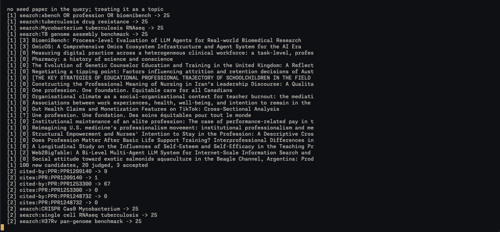

# tb-agentic-search




Two capabilities, with the LLM calls going through
[Biomni](https://github.com/snap-stanford/Biomni)'s Groq plumbing:

- **Retrieval** (`--search`) — give it a request such as "find me relevant
  papers like this paper <paper-url>". It resolves the seed paper on Europe
  PMC, gathers candidates from the seed's references, its citing papers and
  keyword searches, ranks them, and has the LLM score the best ones. Papers it
  accepts seed the next round. Every returned paper is an API record, so none
  can be invented. `--no-llm` runs it without a model; `--agent` uses the
  Biomni A1 agent instead.
- **Screening** — hand it a folder of documents (PDF or plain text) and it
  returns an assessment per document: `tb_related`, a 0–3 `relevance`, paper
  type, drugs, genes/variants, methods, datasets, and an `evidence` quote that
  is checked against the text (`evidence_verified`).

The design and the papers behind it are in [LIT_REVIEW.md](./LIT_REVIEW.md).

Screening has two modes:

- **light** (default) — one small LLM call per document (~1.5k tokens), so a
  free Groq account's 8000-tokens-per-minute budget holds.
- **`--agent`** — the full Biomni A1 agent tool loop. A1's system prompt is
  ~35k tokens, so this needs a Groq tier with a bigger TPM budget.

## Setup

```bash
uv sync
cp .env.example .env   # then fill in GROQ_API_KEY
```

## Usage

```bash
uv run cli.py                               # screens ./papers, or ../papers when ./papers is absent
uv run cli.py ../papers                    # any directory or single PDF/text file
uv run cli.py --scan-only                  # list docs and preview excerpts, no API call
uv run cli.py -o out.json                  # default output: tb_verdicts.json
uv run cli.py --agent                      # full A1 agent loop instead (needs TPM)

uv run cli.py --gold eval/screening_gold.json   # plus accuracy against hand labels

# Retrieval: find related papers from a query / seed URL
uv run cli.py --search "find me relevant papers like this paper https://www.biorxiv.org/content/..."
uv run cli.py --search "..." --max-papers 20 -o found.json
uv run cli.py --search "..." --rounds 3 --budget 10   # more rounds, fewer LLM calls per round
uv run cli.py --search "..." --no-llm                 # text-overlap ranking, no API key
uv run cli.py --search "..." --agent --verbose        # the Biomni A1 agent instead

# Evaluation: hide the seed's reference list and see how much of it is found
uv run cli.py --eval-retrieval "https://www.biorxiv.org/content/..." --no-llm
```

A search run echoes each lookup as it goes (the round number in brackets),
then each assessed paper with its 0–3 relevance, then the papers it settled on:

```
Searching [2 round(s), Groq/openai/gpt-oss-120b]
  query: find me relevant papers like this paper https://...

  seed: BIG-TB: A benchmark for ... (2026) [PPR:PPR1226747]
  [1] cited-by:PPR:PPR1226747 -> 53
  [1] search:rifampicin katG mutation -> 25
  [1] [3] Benchmarking the translational potential of AI-based drug-resistance ...
  [1] 148 new candidates, 8 judged, 4 accepted

Papers related to the query (8):
   1. TB-Bench: A Systematic Benchmark of ... (2026) [europepmc]
      https://doi.org/10.64898/2026.04.08.717138
      Provides a TB drug resistance benchmark similar to BIG-TB.
```

Runs accumulate in `tb_search.db` (SQLite): papers, cached assessments, and a
step-by-step trace of every run.

## Flags

| flag | meaning |
| --- | --- |
| `input` (optional) | Directory or file to screen; defaults to `./papers`, else `../papers` |
| `--search QUERY` | Retrieval request; typically names a seed paper by URL/DOI. Output: `tb_papers.json` |
| `--eval-retrieval SEED` | Recall of SEED's held-out reference list. Output: `eval_retrieval.json` |
| `--max-papers` | `[--search]` Cap on papers returned (default 10) |
| `--rounds` | `[--search]` Discovery rounds (default 2) |
| `--budget` | `[--search]` Papers the LLM assesses per round (default 20) |
| `--no-llm` | `[--search]` Rank by text overlap only; needs no API key |
| `--db` | `[--search]` SQLite file for papers, assessments and traces (default `tb_search.db`) |
| `--gold JSON` | `[screening]` Hand labels `{filename: true/false}`; prints accuracy |
| `-o, --output` | JSON results path (default `tb_verdicts.json`, or `tb_papers.json` with `--search`) |
| `--model` | Groq model id (default: `$GROQ_MODEL` or `openai/gpt-oss-120b`) |
| `--agent` | Use the full A1 agent tool loop, for screening or `--search` |
| `--batch-size` | `[--agent]` Documents per agent call (default 2) |
| `--max-chars` | Excerpt length per document (default 3000) |
| `--tools` | `[--agent]` Let the agent retrieve a relevant tool subset |
| `--data-lake` | `[--agent]` Let biomni pull its full data lake (tens of GB) |
| `--timeout` | `[--agent]` Per-execution timeout in seconds |
| `--temperature` | Sampling temperature (default 0.2) |
| `--verbose` | `[--search --agent]` Also print biomni's full step-by-step agent output |
| `--scan-only` | List docs and preview excerpts; no LLM call |

## Layout

```
cli.py             CLI entry point
tb_search/
  config.py        Settings loaded from .env / environment
  documents.py     collect files, extract text and section-aware excerpts
  prompts.py       the assessment, query-writing and agent prompts
  verdicts.py      salvage JSON out of whatever the model returned
  sources.py       Europe PMC: seed lookup, references, citations, search
  discovery.py     the discovery loop: expand, rank, assess, repeat
  assess.py        structured assessment of a paper or local document
  store.py         SQLite: papers, cached assessments, run traces
  evaluate.py      retrieval recall and screening accuracy
  screening.py     LLM/agent construction and agent-mode screening
  retrieval.py     one A1 agent run: query (+ seed paper URL) -> paper rows
  report.py        summary line + JSON output (verdicts and search runs)
eval/              hand labels for screening
```

