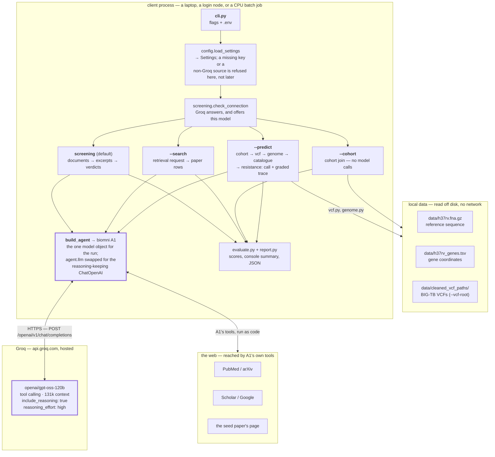

# tb-knowledge-discovery


Three capabilities, each one a run of the
[Biomni](https://github.com/snap-stanford/Biomni) A1 agent against a model on
[Groq](https://console.groq.com/docs/overview)'s inference endpoint (see
[Running on Groq](#running-on-groq)). No model to serve, no GPU — one key.

- **Retrieval** (`--search`) — give it a request such as "find me relevant papers
  like this paper <paper-url>". A1 resolves the seed paper and searches for
  related work with its own retrieval tools (`query_pubmed`, `query_arxiv`,
  `query_scholar`, `search_google`, `extract_url_content`), and the paper list
  is read out of its reply.
- **Screening** — hand it a folder of documents (PDF or plain text) and it
  returns a verdict per document: `tb_related`, a confidence, a reason, and an
  `evidence` quote that is checked against the excerpt the agent was shown
  (`evidence_verified`).
- **Resistance prediction from VCFs** (`--cohort`, `--predict`) — ingest the
  BIG-TB isolate VCFs, and for a given drug predict `resistant` /
  `not_resistant` / `unknown` with a reasoning trace. Calls are scored against
  the phenotypic DST labels, and each trace is graded against the variants the
  model was actually shown.

Groq returns the model's thinking as its own field when asked to, which is what
makes the reasoning traces usable: every prediction stores that trace verbatim
beside the variants it was shown. And because inference is hosted, a run needs
nothing from the cluster but wall time and a network route — what used to be an
A100 reservation is now a CPU job, or your laptop.

A1's system prompt is ~35k tokens and rides on every step of every run, so the
model has to have a context window well past that and has to support tool
calling. That is the one hard requirement this design buys: there is no
small-call fallback path. The default `openai/gpt-oss-120b` has 131k of context
and does its tool calling on Groq's side; what it costs is that those ~35k
tokens are billed and counted against the per-minute limit on every step.

## Setup

```bash
uv sync
cp .env.example .env            # then put your key in it
export GROQ_API_KEY=gsk_...     # or keep it in the environment instead
```

Every mode but `--cohort` calls Groq, and the key is the one thing in `.env`
with no default — keys are at
[console.groq.com/keys](https://console.groq.com/keys). Everything else has
one: the default model is `openai/gpt-oss-120b` at
`https://api.groq.com/openai/v1`, so `--model` is usually the only provider
flag worth passing.

## Running the whole experiment

```bash
./run.sh            # the quick job: one drug, 8 isolates, 1h cap
./run.sh full       # the full four-drug run
./run.sh local      # submit nothing; run the stages in this shell
```

Then wait. `run.sh` submits the job, prints why it is still pending while it
is, follows the log once it starts, and ends by printing the run's summary and
the folder and tarball to send on. Ctrl-C detaches without cancelling the job;
`./run.sh --attach <jobid>` picks it back up, and `scancel <jobid>` is the way
to actually stop it. It checks for `uv`, the job script and the resistance
table before submitting — and for the key, because a job without one queues
for twenty minutes and then dies on its first Groq call. The usual reasons a
job dies show up on your terminal instead of at the bottom of a log.

Everything below still works and `run.sh` passes it through:

```bash
DRUGS="rifampicin isoniazid" LIMIT=20 ./run.sh full
QUICK_LIMIT=4 ./run.sh
MODEL=openai/gpt-oss-20b ./run.sh full
```

`run_experiment.sh` is the layer underneath — the three stages themselves —
and can still be run directly:

```bash
./run_experiment.sh
```

From a Unity login node that submits `scripts/run_unity_cpu.sbatch`, which runs
this same script inside a batch job — CPUs only, because inference is Groq's.
`LOCAL=1 ./run_experiment.sh` runs the stages on the login node itself, and off
a cluster there is nothing to submit to so that is what happens anyway. Three
stages: the cohort join (no model involved, so it fails fast if the data is
unreadable), resistance prediction per drug, and literature screening against
the hand labels in `eval/`. A stage that fails is recorded and the rest still
run.

Everything lands in `results/<run-id>/`, which is the folder to hand to someone
else — raw JSON exactly as the pipeline wrote it, every stage's full log, the
model and commit and seed the numbers came from, and a `SUMMARY.md` that reads
first. `scripts/collect_results.sh` is what writes that summary, the
`metrics.csv` beside it and a `.tar.gz` of the folder; `run_experiment.sh`
calls it at the end, and you can re-run it on any run folder:

```bash
scripts/collect_results.sh                    # the newest run
scripts/collect_results.sh results/<run-id>   # a particular one
```

Every run is also sampled while it runs — and with inference hosted, the only
record of what a request cost is the response itself, so the pipeline keeps it.
`tb_search/usage.py` files one line per request into
`logs/groq_usage.jsonl` (tokens in and out, how much of the output was
thinking, how long Groq queued it) and one line per second spent waiting out a
rate limit. `scripts/monitor_run.sh`, started and stopped by
`run_experiment.sh`, rolls that up per tick into `logs/groq_timeline.csv`, and
`logs/stages.jsonl` records each stage's exit code, start time and duration
beside them.

These answer the question the stage logs cannot, which has changed shape along
with the backend. It used to be *was the card saturated or idle?*; it is now
*was the model thinking, or were we being throttled?* — completion and
reasoning tokens up with queue time flat is the first, queue time and wait
seconds up is the second, and the two call for opposite fixes (a lower
`--reasoning-effort` against the first, fewer isolates in flight or a higher
tier against the second). `SUMMARY.md` carries the headline figures under
**Run monitoring** and says which reading its run looks like.

`results/runs.csv` is one row per run across every run that has finished,
successful or not: model, effort, seed, commit, which stages failed, total
time, requests made, tokens in and out, thinking tokens, mean queue time and
seconds lost to rate limits. It is rewritten by run id, so re-running
`collect_results.sh` on a folder corrects that run's row rather than adding
another.

To watch a Slurm job, including the live usage timeline and stage durations:

```bash
scripts/watch_job.sh              # the newest job of yours in the queue
scripts/watch_job.sh 1234567      # a particular one
scripts/monitor_run.sh status results/<run-id>    # just the last samples
```

The knobs are environment variables, so the defaults stay out of the command:

```bash
DRUGS="rifampicin isoniazid" LIMIT=40 EFFORT=high ./run_experiment.sh
VCF_ROOT=/project/.../vcfs ./run_experiment.sh    # VCFs not where the cohort says
MODEL=openai/gpt-oss-20b MAX_RETRIES=10 ./run_experiment.sh
```

`DRUGS` (default: rifampicin, isoniazid, ethambutol, pyrazinamide), `LIMIT`
isolates per drug, `BALANCE=1` for equal R and S, `SEED` so a run repeats,
`EFFORT`, `RUN_ID` to name the folder, `MODEL` for a different Groq model,
`MAX_RETRIES` for how long to wait out a 429, `TOOLS=1` for a retrieved tool
subset (see [the rate limit](#the-rate-limit-is-the-new-gpu) — it is what
decides whether a low tier fits at all), and `LOCAL=1` to run here rather than
submit.

## Resistance prediction from VCFs

The dataset comes from two files in `data/cleaned_vcf_paths/`:
`master_resistance_table.csv` (phenotypic DST, R/S per isolate per drug) and
`big_tb_file_paths.txt` (the BIG-TB VCF paths on the cluster). They join on the
table's `New_ID` column, which matches the VCF filename stem for all 17,942
BIG-TB isolates, giving a labelled dataset per drug — 17.6k isolates for
rifampicin, 17.4k for isoniazid, down to a few dozen for the rarely tested
drugs.

Variants are named without needing an annotated VCF. Each position is looked up
in `data/h37rv_genes.tsv` (NCBI's feature table for H37Rv, NC_000962.3) to get
the gene, the codon number, or a promoter offset, and the codon is then
translated against the reference in `data/h37rv.fna.gz` to get the actual
protein consequence. So `761155 C>T` is presented as `rpoB S450L`, `761156 G>A`
as `rpoB S450S synonymous`, `1673425 C>T` as `fabG1 -15 (promoter)` and a 1 bp
deletion in pncA as a frameshift. When the VCF carries its own `ANN`/`CSQ`
field, that annotation is used instead.

Naming the protein change matters more than it looks: shown only "rpoB codon
453", the model calls any hotspot codon resistant, because it cannot tell a
silent change from a missense one. Shown "rpoB S450S synonymous", it correctly
rules the variant out.

Because the reference is loaded anyway, every record's `REF` is checked against
H37Rv. A run that reports mismatches was called against a different reference or
has shifted coordinates, and its gene and codon assignments cannot be trusted.

Variants are then filtered to the genes the WHO catalogue grades for that drug,
split into tier 1 (established mechanism) and tier 2 (secondary).

**Each trace is checked, not just read.** Every prediction is stored next to the
variants it was shown, so three things are verified mechanically:

| check | what it catches |
| --- | --- |
| `variants_resolve` | the model cited a variant that was never in the VCF |
| `genes_on_panel` | the model reasoned from a gene not graded for that drug |
| `call_grounded` | a `resistant` call that rests on no variant at all |

`tier1_support` additionally records whether the call rests on a tier 1 gene
rather than only a secondary one. A trace is `valid` when nothing in it was
invented or self-contradictory — accuracy and trace validity are reported
separately, because a run can be accurate and still be reasoning from variants
that were not there.

```bash
# the labelled dataset size per drug; no LLM calls
uv run cli.py --cohort

# predict, on a balanced sample, with the VCFs mounted locally
uv run cli.py --predict isoniazid --limit 40 --balance --vcf-root /path/to/vcfs
uv run cli.py --predict rifampicin --limit 100 --balance --seed 1
```

The BIG-TB VCFs live on the cluster, so `--vcf-root` points at wherever they
actually are; without it the recorded cluster path is used as-is. A run prints
one line per isolate (the call, whether it matched the DST, and any trace
problem) and ends with accuracy, sensitivity, specificity, PPV/NPV, the
confusion matrix and the trace rates. `tb_resistance_<drug>.json` holds every
prediction with its variant list, reasoning and trace grade.

## Running on Groq

Inference is [Groq](https://console.groq.com/docs/overview)'s. There is no
server to start, no weights to place and no card to reserve: the pipeline is an
HTTP client with a key, and A1's tool calling happens against that same
endpoint.

```bash
export GROQ_API_KEY=gsk_...
uv run cli.py --predict rifampicin --limit 40 --balance --reasoning-effort high
```

Biomni calls this its `Groq` source, and it is the only backend this repo
offers. The hosted and local ones biomni also knows (OpenAI, Anthropic, Gemini,
Bedrock, Azure, Ollama, Custom) are deliberately refused in
`config._resolve_source`, so a leftover `LLM_SOURCE` from the vLLM days is
reported and ignored rather than quietly changing what answered.

### The model

The default is `openai/gpt-oss-120b`, because it is the one Groq model that does
everything this pipeline needs at once:

| requirement | why | `openai/gpt-oss-120b` |
| --- | --- | --- |
| tool calling | A1 calls its tools as code; without it there is no agent | yes |
| context ≫ 35k | A1's system prompt rides on every step | 131,072 tokens |
| separated reasoning | the traces are the point of the run | in the `reasoning` field |
| an effort scale | traces only compare across runs at equal effort | `low`/`medium`/`high` |

`--model openai/gpt-oss-20b` is the same four properties on a smaller model and
is what `scripts/run_unity_quick.sbatch` uses; `--model qwen/qwen3.8-27b` also
reasons, with `none`/`default` as its effort values instead. Groq's catalogue
moves — ids get added, promoted out of preview and retired — so
`check_connection` lists the models the account can actually reach and refuses
an id that is not among them, by name, before the run starts.

### Asking for the thinking

Two request fields do this on Groq and they are mutually exclusive, so
`reasoning.reasoning_body` picks by model family:

| model | field sent | why |
| --- | --- | --- |
| `openai/gpt-oss-*` | `include_reasoning: true` | these reject `reasoning_format` outright and return `reasoning` by default |
| everything else | `reasoning_format: "parsed"` | `parsed` splits the thinking into its own field |

`raw` is never sent: it leaves the thinking inline in `<think>` tags *and* is a
400 as soon as tool calling or JSON mode is on, which for an A1 run is always.
`--reasoning-effort` rides along in the same body. It is recorded in the output
JSON, because traces are only comparable across runs at the same effort, and
which values a model accepts is the model's business — Groq answers an effort
the model does not know with a 400 rather than a silent default, which
`check_connection` surfaces before the sweep rather than during it.

### The rate limit is the new GPU

What could go wrong has moved. A server we served ourselves could be down, be
serving a different model id, or run out of context window; a hosted endpoint
is up, and what it does instead is refuse you for being over your share —
requests and tokens per minute, and per day.

So `retry_transient` is where the care went. A 429 carries `retry-after`, and
the body repeats it to the millisecond ("Please try again in 7.481s"); whichever
is there is obeyed, plus a second of slack so the window has actually rolled
over by the time the retry lands. With no instruction the wait doubles from 5s
per attempt, with jitter, capped at 90s. `--max-retries` (default 5) is how many
times one request waits before its batch or isolate is given up on — and giving
up is per batch and per isolate, so a sweep survives one item it could not get
through.

What is *not* retried matters as much: a prompt past the context window, a bad
key, a model this account cannot reach and an effort the model does not accept
all fail again identically, so they are raised at once. `is_context_error` is
careful here, because a rate-limit message names a limit in tokens and must not
read as a context-length failure.

**The one that will catch you first.** A single A1 request is almost entirely
its own system prompt, and Groq refuses a request bigger than the account's
whole per-minute budget with a 413 that reads like a rate limit:

```
Error code: 413 - Request too large for model `openai/gpt-oss-120b` ...
on tokens per minute (TPM): Limit 8000, Requested 36071
```

Waiting cannot fix that — the request does not fit in a whole minute's
allowance — so `is_token_budget_error` holds it apart from both the retried
errors and the context-window ones, and the hint says what actually moves the
number. Measured on this repo, screening one document:

| | tokens per request |
| --- | ---: |
| the whole tool catalogue in the system prompt | ~36,100 |
| `--tools` — A1 retrieves a tool subset instead | ~10,700 |
| Groq free tier's limit | 8,000 |

So `--tools` is the one real lever, and `--batch-size`/`--max-chars` are not:
the documents are a rounding error next to the catalogue. Past `--tools` the
tier has to go up; an A1 run does not fit in a free-tier minute at all. This is
the GPU-hours cost of the old design reappearing as a token budget, and it is
the reason `BIOMNI_USE_TOOL_RETRIEVER` is worth setting in `.env` rather than
remembering the flag.

Every second spent waiting is recorded (`logs/groq_usage.jsonl`), which is what
lets `SUMMARY.md` tell a run that was slow because the model was thinking from
one that was slow because the account was throttled.

### What ends up in the traces

Each prediction carries two: `reasoning`, what the model wrote into its answer,
and `reasoning_trace`, the thinking Groq returned separately. They can disagree,
and the second is the one that shows how the call was actually reached, so it is
what the biological-validity read-through works from. The run summary reports how
many calls came with thinking attached and the median length; a model that
returns none yields empty traces and the summary says so.

With `reasoning_content` as the field's other spelling, and langchain's
`ChatOpenAI` dropping both as non-standard, `tb_search/screening.py` subclasses
it to keep them — otherwise the traces never reach us at all.

A1 makes that harder than a plain chat call does. Its `generate` step rebuilds
every reply as a fresh `AIMessage`, so `additional_kwargs` — and the
`reasoning` field with it — is gone by the time the step reaches the agent's
graph state. So the subclass also appends each trace to a list that
`build_agent` hands it, and `run_agent` reads that list back per run: the whole
run's thinking, step by step, which with a tool loop in the middle is what the
answer was actually reasoned from. The same subclass is where every response's
`usage` block is filed, since that is the only place a hosted run's cost is
visible.

### On the cluster

Nothing needs a GPU any more, but a four-drug sweep is still hours of wall time
and a login node is still the wrong place to spend them, so
`scripts/run_unity_cpu.sbatch` is a batch job that asks for CPUs and runs the
pipeline as a client:

```bash
export GROQ_API_KEY=gsk_...      # sbatch exports your environment to the job
sbatch scripts/run_unity_cpu.sbatch experiment
sbatch scripts/run_unity_cpu.sbatch --predict rifampicin --limit 40 --balance
sbatch scripts/run_unity_cpu.sbatch --search "fluoroquinolone resistance"
tail -f logs/tb-groq-<jobid>.out
```

`--partition=cpu` is Unity's default partition, so this queues in minutes.
`--time=08:00:00` is what a four-drug run at `--limit 20` fits inside with room
for the rate limit; `sbatch --time=24:00:00 ...` for a longer sweep, and
`SBATCH_ARGS` passes through from `run.sh` and `run_experiment.sh` for anything
else. Everything the old A100 job had to get right — a card with the capability
for the kernel, a quantization that fits it, a context window past A1's system
prompt, waiting out the weight load — is the provider's problem now. What is
left is the key reaching the job and the account's limits.

## Usage

**Screening local documents**

```bash
uv run cli.py                        # screens ./papers, or ../papers when ./papers is absent
uv run cli.py ../papers               # any directory or single PDF/text file
uv run cli.py -o out.json             # default output: tb_verdicts.json
uv run cli.py --batch-size 1          # one document per agent run, for a tight context window
uv run cli.py --gold eval/screening_gold.json   # plus accuracy against hand labels
```

Documents go to the agent `--batch-size` at a time, as section-aware excerpts
(the opening, plus the starts of the methods and closing sections — the opening
alone cannot tell a TB methods paper from one that names TB in passing). A batch
whose reply will not parse is retried once with a stricter reminder, then left
as `unknown`, so one bad agent run cannot end a pass over a whole directory.

**Retrieval**

```bash
uv run cli.py --search "find me relevant papers like this paper https://www.biorxiv.org/content/..."
uv run cli.py --search "..." -n 20 -o found.json   # at most 20 papers
uv run cli.py --search "..." --verbose             # biomni's full step-by-step agent output
```

A retrieval run echoes the agent's searches as it makes them (the step number in
brackets), then the papers it settled on:

```
Searching for up to 10 paper(s) [A1 agent, Groq openai/gpt-oss-120b effort high]
  query: find me relevant papers like this paper https://...

  [2] extract_url_content(https://www.biorxiv.org/content/...)
  [4] query_pubmed(rifampicin resistance prediction whole genome sequencing)
  [6] query_scholar(tuberculosis drug resistance benchmark)
  [8] agent wrote up its answer

Papers related to the query (8):
   1. TB-Bench: A Systematic Benchmark of ... (2026) [pubmed]
      https://doi.org/10.64898/2026.04.08.717138
      Provides a TB drug resistance benchmark similar to BIG-TB.
```

Every row has to carry a title the agent actually returned, and the agent is
told never to invent one — but unlike a search against a source API directly,
nothing here can *prove* a row came from a real record. Spot-check the links.

## Architecture

One process and an HTTP boundary. The pipeline runs wherever you launched it —
a laptop, a login node, a batch job — and knows the model only as a Groq model
id; the weights are Groq's problem. Nothing here holds state the endpoint needs,
so the model id can be swapped without touching the code, and the same command
runs identically on a laptop and in a job.



The layering is deliberate in three places:

- **Biomni supplies the agent; the pipeline around it is this repo's.** A1
  brings the tool loop, the tool catalogue and its own ~35k-token system
  prompt. Every task prompt, the VCF reader and all the grading are this
  repo's (see [How it uses Biomni](#how-it-uses-biomni)).
- **The genomic layer is pure and offline.** `vcf.py`, `genome.py` and
  `catalogue.py` turn a VCF into named, panel-filtered variants with no model
  in the loop, which is why `tests/` can cover them without a server.
- **Grading is separate from predicting.** `resistance.check_trace` and
  `evaluate.py` only read rows, so a finished run can be re-scored from its JSON.

## How a run flows

Every mode enters through `cli.py`, which parses flags, loads `Settings` from
`.env` and picks a path. Everything below the CLI is plain Python, and every
model call is `run_agent` — one `agent.go()` over one task prompt.

**Screening (the default mode)**

```
cli.py run_screening
  load_settings            config.py      .env -> Settings
  resolve_input            documents.py   the directory or single file to read
  collect_docs             documents.py   every PDF/text under it
  check_connection         screening.py   Groq's model list + a 1-token call, so a bad key or model id fails here
  build_agent              screening.py   biomni.agent.A1, wired to Groq
  classify_documents_agent screening.py   one agent run per --batch-size documents
    section_excerpt        documents.py   opening + methods + conclusion
    BATCH_SCREEN_PROMPT    prompts.py     the listing -> one JSON list
    run_agent              screening.py   agent.go, plus the run's thinking
    parse_verdict_list     verdicts.py    salvage that JSON from prose or code fences
    quote_in_text          verdicts.py    the evidence quote checked against the excerpt
  write_results            report.py      console lines + tb_verdicts.json
```

**Retrieval (`--search`)**

```
cli.py run_search
  build_agent            screening.py   as above
  retrieve_papers        retrieval.py   one agent run on the request
    RETRIEVAL_PROMPT     prompts.py     fetch the seed, then search; reply as a JSON list
    go_stream            biomni         step by step, so the searches can be echoed
    _searches            retrieval.py   the tool calls, read back out of the code A1 wrote
    parse_paper_list     verdicts.py    salvage the rows from the final reply
  write_papers           report.py      rows -> tb_papers.json
```

`--predict` is the same shape per isolate: the VCF is read and named offline,
`RESISTANCE_PROMPT` hands the agent the numbered variant list, and the reply is
parsed, normalized and then checked against what was in that list.

## The lifecycle of one request

Setup happens once per run; the rest repeats per document, per candidate paper
or per isolate. The model is never trusted to have answered well — every reply
is salvaged, normalized and checked before it becomes a row.

```mermaid
flowchart TB
    subgraph setup["once, before the first call"]
        L1["config.load_settings<br/>.env + flags → Settings"]
        L2["screening.check_connection<br/>the model list, then a 1-token call:<br/>a dead key, an id this account cannot<br/>reach, or an effort the model<br/>rejects, all fail here"]
        L3["screening._prime_environment<br/>GROQ_API_KEY, where biomni's<br/>own Groq branch looks"]
        L4["build_agent<br/>one A1 agent for the whole run;<br/>agent.reasoning_traces attached"]
        L1 --> L2 --> L3 --> L4
    end

    subgraph percall["per document, per candidate paper, per isolate"]
        P1["task prompt built — prompts.py<br/>a batch of section excerpts, a numbered<br/>variant listing, or the retrieval request"]
        P2["screening.run_agent<br/>agent.go — A1's tool loop, its ~35k-token<br/>system prompt on every step"]
        P3["screening.retry_transient<br/>POST /openai/v1/chat/completions, per step"]
        P4["Groq<br/>answers with the thinking in its own<br/>reasoning field, plus a usage block"]
        P5["(answer, trace) — langchain drops that<br/>field as non-standard and A1 rebuilds the<br/>message, so the ChatOpenAI subclass files<br/>each trace in agent.reasoning_traces<br/>and each usage block in groq_usage.jsonl"]
        P6["verdicts.parse_verdict_list<br/>or resistance.parse_prediction<br/>the JSON, out of prose, fences or solution tags"]
        P7["verdicts.quote_in_text — screening<br/>the evidence quote checked against the excerpt<br/><br/>normalize_prediction — resistance.py<br/>the call folded to one of three"]
        P8["resistance.check_trace<br/>variants_resolve, genes_on_panel,<br/>call_grounded, tier1_support"]
        P9["one row, always"]
        P1 --> P2 --> P3 --> P4 --> P5 --> P6 --> P7 --> P8 --> P9
        RETRY["429 or a 5xx: waited out --max-retries<br/>times, obeying Groq's own retry-after.<br/>a context-length failure, a bad key or a<br/>rejected effort: not retried, it would<br/>repeat — cut --batch-size, or fix the flag"]
        P3 -.-> RETRY -.-> P3
        P6 -.->|"unreadable VCF, failed call,<br/>unparseable reply → a row<br/>carrying an error, so one bad<br/>input cannot end a sweep"| P9
    end

    subgraph finish["once, at the end"]
        F1["evaluate.py<br/>accuracy and trace validity scored apart:<br/>a run can be accurate and still reason<br/>from variants that were not there"]
        F2["report.py<br/>console summary + JSON, with the model id<br/>and reasoning effort recorded — traces<br/>only compare across runs at equal effort"]
        F1 --> F2
    end

    L4 --> P1
    P9 -->|"next item"| P1
    P9 --> F1

    classDef remote stroke-width:3px
    class P4 remote
```



One `agent.go()` is however many requests A1's tool loop needs, each carrying
that system prompt, so the per-item cost is set by how many steps the agent
takes rather than by the task prompt's length. `--tools` lets A1 retrieve a
relevant tool subset instead of carrying the whole catalogue, which is the one
lever on that cost short of a smaller prompt.

## How it uses Biomni

Biomni supplies the agent; the pipeline around it is this repo's, including
every task prompt (`prompts.py`). A1 brings its own system prompt — who it is,
the tool catalogue, the `<execute>`/`<solution>` protocol — but no task prompts,
because its design is that the caller supplies the task in `agent.go(...)`.
The touchpoints are few:

| Biomni piece | Where | Used for |
| --- | --- | --- |
| `biomni.agent.A1` | `screening.build_agent` | the one model object: tool loop, tool retriever, data-lake switch |
| `biomni.config.default_config` | `screening.build_agent` | temperature, model and provider; A1 forwards `llm`/`source` but not `temperature` |
| biomni's `Groq` source | `config.GROQ_SOURCE` | the branch that points langchain at api.groq.com with the key from the environment |
| `agent.go(prompt)` | `screening.run_agent` | every task: screening batches, and one resistance prediction per isolate |
| `agent.go_stream(prompt)` | `retrieval._run_streamed` | search step by step, so its tool calls can be echoed |
| A1's retrieval tools | the `--search` run | `query_pubmed`, `query_arxiv`, `query_scholar`, `search_google`, `extract_url_content`, called as code inside `<execute>` |
| `agent.configure()` | `screening.build_agent` | rebuild the graph after the model swap, so the swap holds whenever biomni reads `self.llm` |

**Every model call is an A1 run.** The three modes reach the model only through
`run_agent` (`agent.go`) or `retrieval._run_streamed` (`agent.go_stream`), and
the agent's own tool retriever is handed that same model object, so one swapped
`agent.llm` is the whole surface. The single exception is deliberate:
`check_connection` makes one direct `max_tokens=1` call as a preflight, because
a dead key should fail in two seconds with a readable reason rather than inside
a tool loop behind ~36k tokens of system prompt. A test asserts no task path
grows a second one.

Seven details are easy to get wrong, which is why the code spells them out:

- The source is always passed explicitly. Biomni's auto-detection sees the
  slash in a model id like `openai/gpt-oss-120b` and would route it to Ollama on
  its own. `Groq` is the branch that points langchain at api.groq.com, which is
  where the agent's tool calling then runs.
- The key is copied into the environment (`GROQ_API_KEY`) before `A1` is built,
  because Biomni's Groq branch reads it from there rather than taking it as an
  argument — so a key that came from our own `.env` handling has to be put back.
- A1 builds its own chat model, which asks for no reasoning and would drop it
  anyway, so `build_agent` replaces `agent.llm` with the reasoning-keeping one
  afterwards; it stays a `ChatOpenAI` subclass because A1 calls
  `with_structured_output` on it, and because Groq's endpoint is
  OpenAI-compatible that is simply the right client for it.
- `agent.configure()` is then called again, which is what A1 itself does after
  its tools change. Its `generate` node reads `self.llm` when it runs, so the
  swap already applies — but that is an assumption about biomni's internals
  whose failure would be silent: the run would work, against biomni's own chat
  model, and every reasoning trace and usage row would quietly come back empty.
  Rebuilding the graph costs a prompt rebuild and makes the swap hold either
  way. Verified on the live agent: the compiled graph invokes the swapped model
  with A1's 156k-character system prompt, and the trace comes back per run.
- `expected_data_lake_files=[]` (not `None`) is what tells A1 to skip its
  tens-of-GB data-lake download; `--data-lake` turns it back on.
- `timeout_seconds` comes from `BIOMNI_TIMEOUT_SECONDS` (default 600) and is
  passed only to A1.
- A1's `generate` step appends a **new** `AIMessage` built from the reply's text,
  so `additional_kwargs` never reaches the graph state and `go()` hands back a
  bare string. The reasoning is therefore collected at the chat model, in
  `agent.reasoning_traces`, and `run_agent` clears that list per run so one
  isolate's thinking is not filed under the next.

That system prompt rides on every step of every run, so the per-item cost is
real and now metered: a sweep over thousands of isolates pays ~35k input tokens
thousands of times, against an account limit measured per minute. `--tools` (a
retrieved tool subset) is the lever on it, and `logs/groq_usage.jsonl` is where
the bill for not pulling it shows up. Where a run can still fail,
`retry_transient` waits out a 429 or a 5xx `--max-retries` times, and a failure
is reported per batch or per isolate instead of ending the run.

## Flags

| flag | meaning |
| --- | --- |
| `input` (optional) | Directory or file to screen; defaults to `./papers`, else `../papers` |
| `--search QUERY` | Retrieval request; typically names a seed paper by URL/DOI. Output: `tb_papers.json` |
| `-n`, `--top` | `[--search]` Upper bound on papers returned, most relevant first (default 10) |
| `--gold JSON` | `[screening]` Hand labels `{filename: true/false}`; prints accuracy |
| `--cohort` | Join the resistance table to the listed VCFs; per-drug dataset sizes. Output: `tb_cohort.json` |
| `--predict DRUG` | Predict resistance to DRUG from each isolate's VCF, with a checked trace. Output: `tb_resistance_<drug>.json` |
| `--vcf-root DIR` | `[--predict]` Where the VCFs actually live, replacing the recorded cluster path |
| `--data-dir DIR` | `[--cohort]`, `[--predict]` Where the cohort files live (default `data/cleaned_vcf_paths`) |
| `--limit N` | `[--predict]` Isolates to predict over (default 20) |
| `--balance` | `[--predict]` Equal numbers of resistant and susceptible isolates |
| `--seed N` | `[--predict]` Sampling seed, so a run repeats (default 0) |
| `--min-af` | `[--predict]` Drop variants below this alternate-allele frequency (default 0, keep all) |
| `--keep-filtered` | `[--predict]` Also use variants the caller did not mark PASS |
| `-o, --output` | JSON results path (default `tb_verdicts.json`, or `tb_papers.json` with `--search`) |
| `--model` | Groq model id to request (default: `$GROQ_MODEL` or `openai/gpt-oss-120b`). It has to support tool calling, and its context window has to clear A1's ~35k-token system prompt |
| `--base-url URL` | Groq's OpenAI-compatible endpoint (default: `$GROQ_BASE_URL` or `https://api.groq.com/openai/v1`). Only worth passing to reach Groq through a proxy |
| `--reasoning-effort LEVEL` | Reasoning effort sent with every request: `none`, `default`, `low`, `medium`, `high`, `xhigh`. Which are accepted depends on the model — `low`/`medium`/`high` for GPT-OSS, `none`/`default` for Qwen (default: `$LLM_REASONING_EFFORT`, else Groq's default for the model) |
| `--max-retries N` | How many times a rate-limited or briefly failing request waits and tries again (default: `$GROQ_MAX_RETRIES` or 5). Groq's 429 says how long to wait and that is obeyed |
| `--source` | Which biomni backend answers (default: `$LLM_SOURCE` or `Groq`). Only `Groq` is offered: this pipeline does not serve its own model |
| `--batch-size` | `[screening]` Documents per agent run (default 2) |
| `--max-chars` | Excerpt length per document (default 3000) |
| `--tools` | Let A1 retrieve a relevant tool subset instead of carrying them all |
| `--data-lake` | Let biomni pull its full data lake (tens of GB) |
| `--temperature` | Sampling temperature (default 0.2) |
| `--verbose` | `[--search]` Also print biomni's full step-by-step agent output |

## Layout

```
run.sh             submit, wait, follow, summarise — the one to run
run_experiment.sh  the three stages themselves; writes results/<run-id>/
cli.py             CLI entry point
scripts/
  run_unity_cpu.sbatch      one Slurm job, CPUs only: run the pipeline as a
                            client against Groq
  run_unity_quick.sbatch    the same experiment cut down — one drug, a smaller
                            model, an hour of walltime
  collect_results.sh        SUMMARY.md, metrics.csv and a tarball for a run folder
  monitor_run.sh            rolls up what each Groq request cost, during a run
  watch_job.sh              queue state, stage progress and usage, refreshed
tb_search/
  config.py        Settings loaded from .env / environment: key, model, effort, retries
  reasoning.py     asking Groq to separate the thinking, and reading it back out
  usage.py         what every request cost: tokens, queue time, rate-limit waits
  documents.py     collect files, extract text and section-aware excerpts
  prompts.py       the task prompts handed to A1: screening, retrieval, resistance
  verdicts.py      salvage JSON out of whatever the model returned; check a quote against its text
  evaluate.py      screening accuracy, resistance scoring, trace grading
  screening.py     A1 construction, one-run-per-prompt, and agent screening
  retrieval.py     one A1 agent run: query (+ seed paper URL) -> paper rows
  report.py        summary line + JSON output (verdicts, searches, predictions)
  genome.py        H37Rv position -> gene, codon, promoter offset, protein change
  catalogue.py     WHO drug -> resistance gene panels, tier 1 and tier 2
  vcf.py           read a VCF into named, panel-filtered variants
  cohort.py        join the resistance table to the VCF paths; per-drug datasets
  resistance.py    predict resistance for one isolate/drug, and grade the trace
data/
  h37rv_genes.tsv        H37Rv gene coordinates (from NCBI NC_000962.3)
  h37rv.fna.gz           the H37Rv reference sequence, for protein consequences
  cleaned_vcf_paths/     the resistance table and the BIG-TB VCF path list
eval/              hand labels for screening
tests/             offline tests for the VCF pipeline and the model layer
```
